# 📊 UIII Act3: Importación y Descripción de Datos
# Jesus Arriaga NC 0019
> **🎓 Asignatura:** Soluciona problemas de Machine Learning  
> **📚 Nivel:** Tercer semestre de preparatoria  
> **🤖 Especialidad:** Inteligencia Artificial  
> **📈 Dificultad:** Cero a principiante  
> **🐍 Lenguaje:** Python  
> **🛠️ Herramientas:** Visual Studio Code, Pandas, Matplotlib y CSV
## Empleados de industria

## TABLA ORIGINAL DE EMPLEADOS
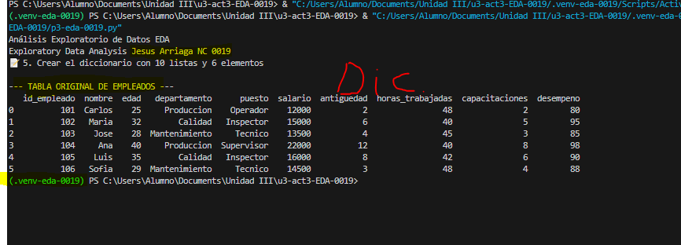
## 💾 7. Convertir el DataFrame en archivo CSV
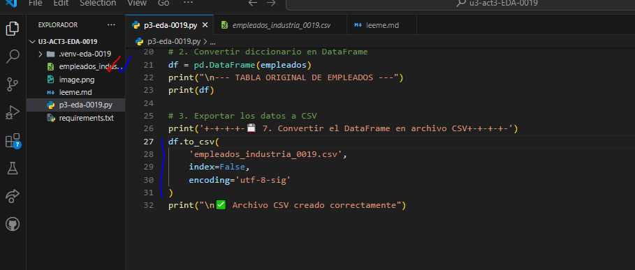
## Datos del cvs --> base de datos 
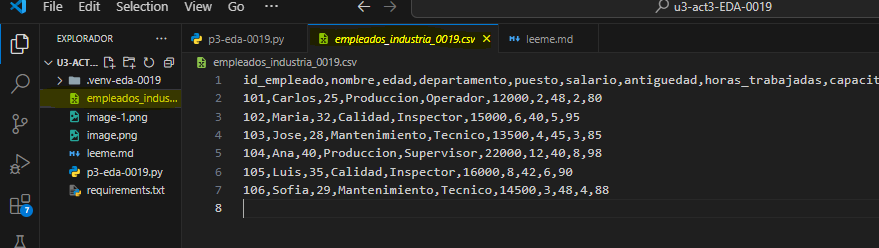
## 📂 8. Leer los datos desde el archivo CSV
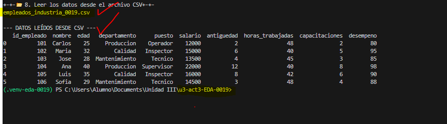
## 🔍 9. Análisis Exploratorio de Datos (EDA)
## Primeros y últimos registros
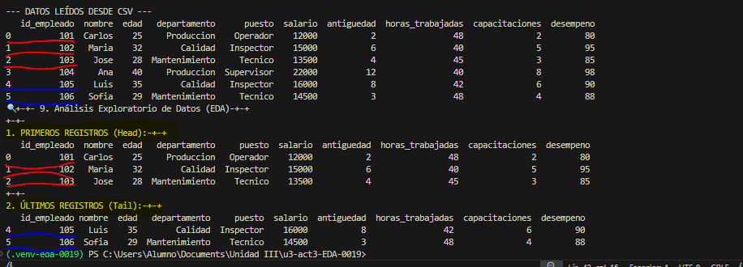

## Dimensiones y estructura
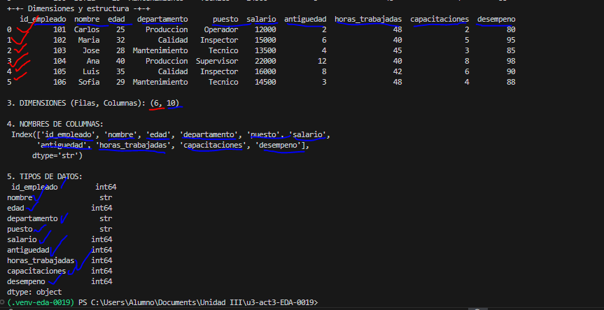
## Estadisticas y limpieza 
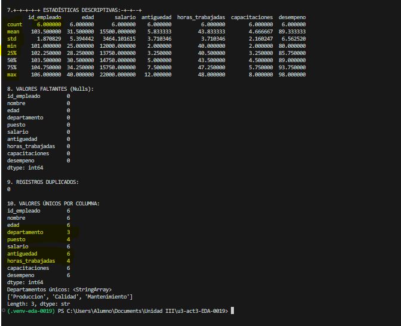
## 8 Y 9 ORDENAMIENTO,filtrado y agrupacion 
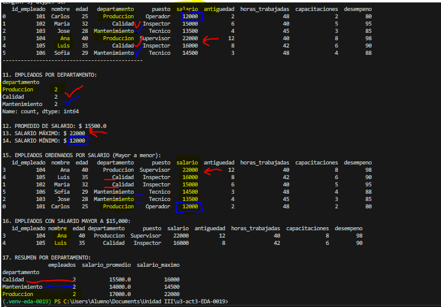
## 18. Gráfica de barras: Empleados por departamento
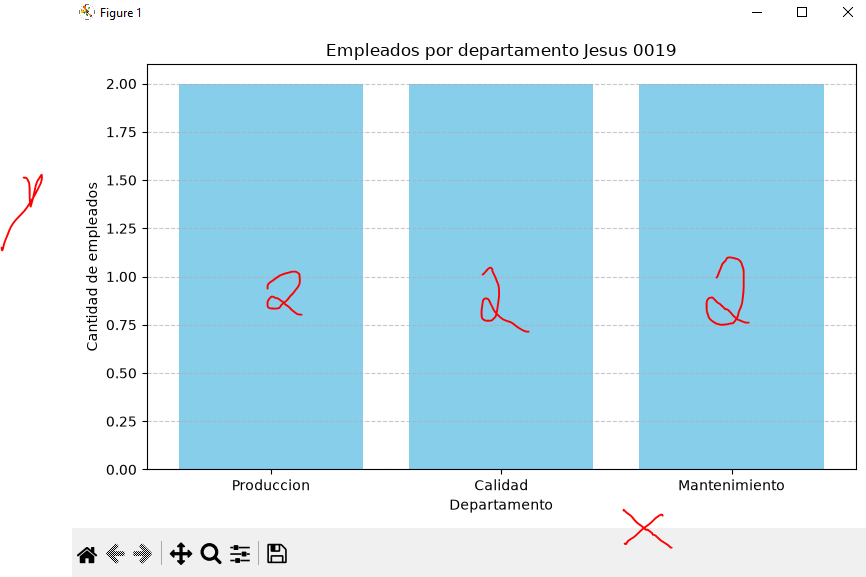
## 19. Gráfica de barras: Salarios por empleado
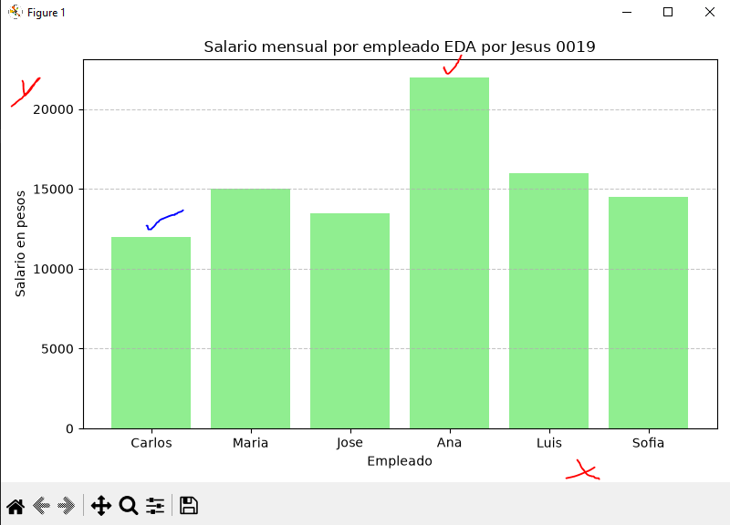.
## 20. Histograma: Distribución de edades
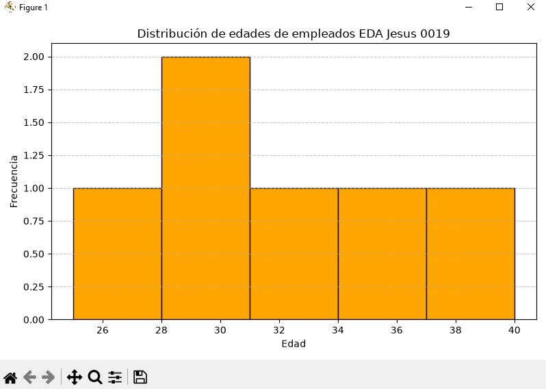
## 21. Gráfica de dispersión: Edad vs Salario
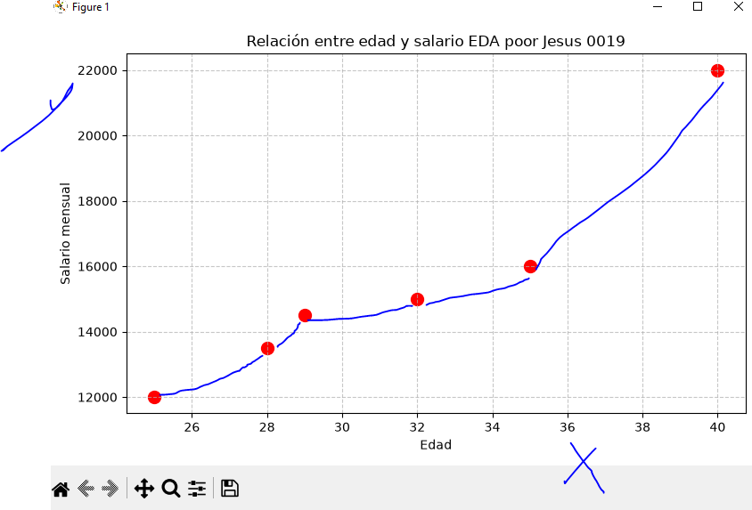
## 22. Diagrama de caja: Distribución de salarios
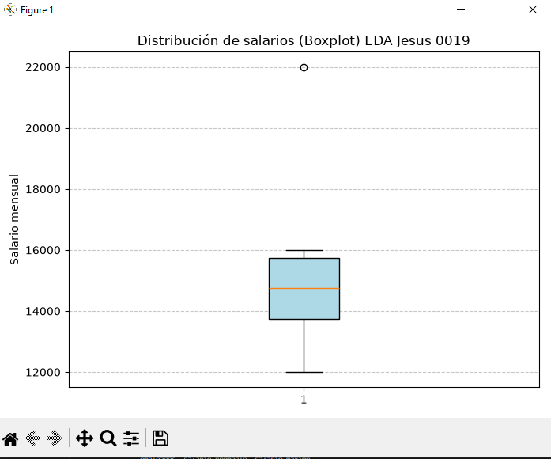
## 23. Matriz de correlación
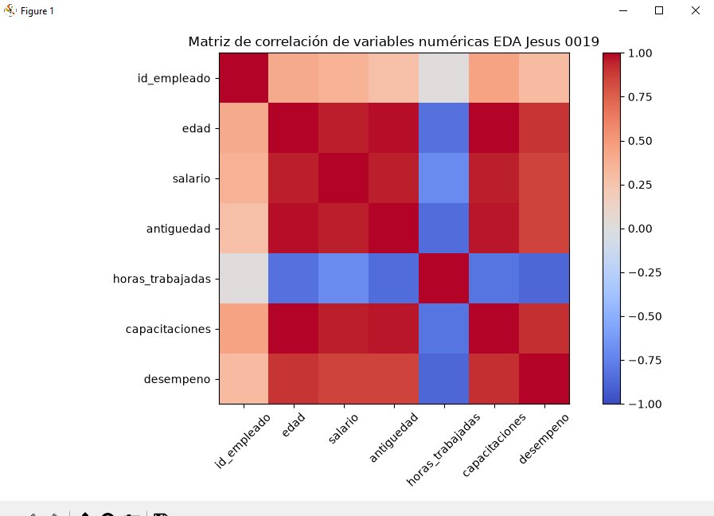